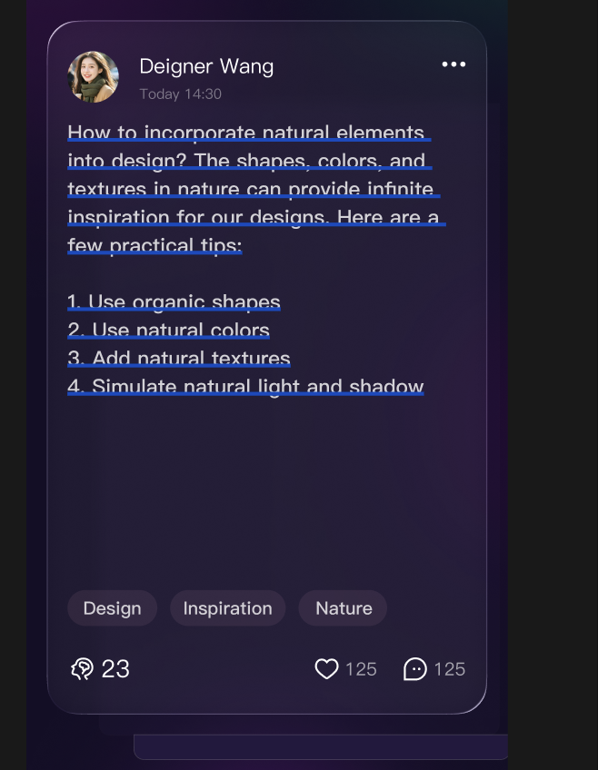
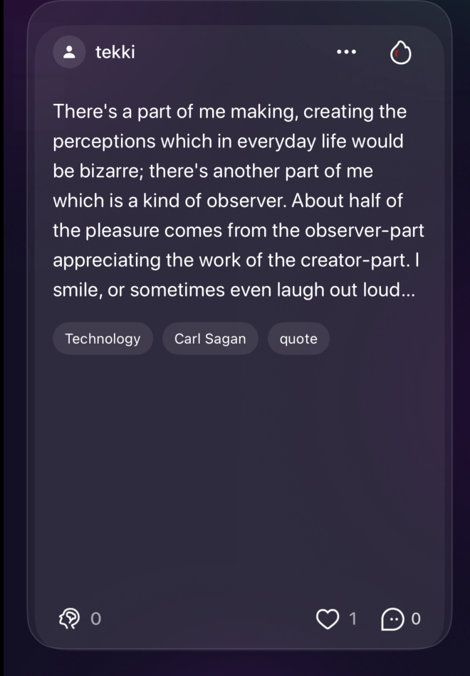
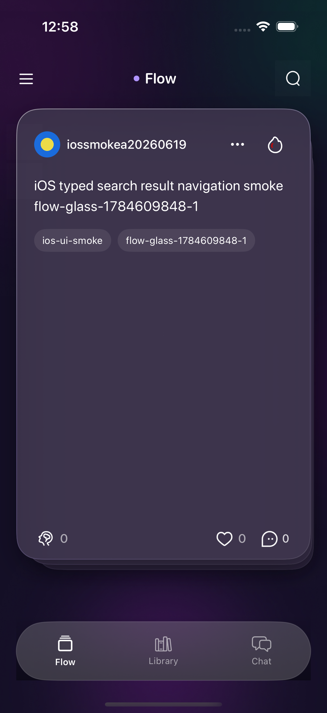
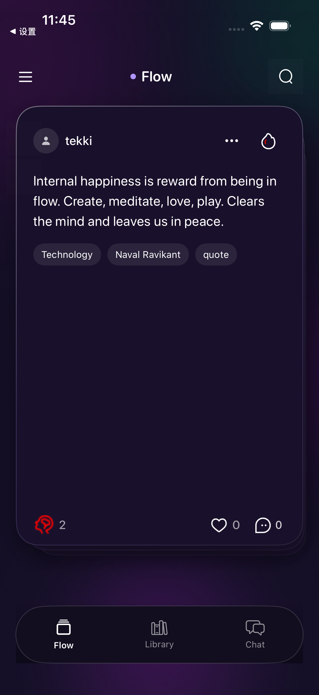
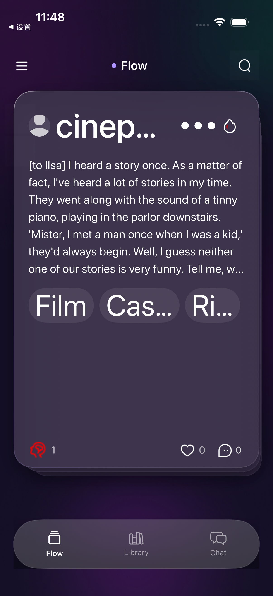

# iOS Flow Glass Card Stack Design QA

## Audit scope

This is a bounded combined design and accessibility audit of the iOS Flow card
surface on an iPhone 17 Pro Simulator in dark appearance. The user goal was to
render valid author avatars and give the existing Flow card a restrained,
reference-aligned glass stack without changing its content or interactions.

The audit compares the approved reference and original reported screen with four
accepted runtime captures, then checks the implementation source, source
contracts, and focused live journeys. It is not a claim of full WCAG or platform
accessibility compliance.

## Visual truth

1. Approved reference, 658 x 848: dark violet glass, a fine light-catching rim,
   and visible rear-card depth.

   

2. Original reported screen, 660 x 950: the avatar had fallen back to the person
   glyph and the stack read as a single heavy surface.

   

3. Main accepted capture, 1206 x 2622: the reusable blue/yellow profile avatar is
   visible from a backend-relative URL, the foreground card has a highlighted
   glass rim, and two content-free rear surfaces are distinct at the bottom and
   right.

   

4. Increase Contrast capture, 1206 x 2622: the brighter foreground and rear rims
   remain controlled and the content stays readable.

   

5. Reduce Transparency capture, 1206 x 2622: the card and rear surfaces use the
   opaque deep-violet fallback and remain visibly separated without background
   bleed.

   

6. Accessibility XXXL capture, 1206 x 2622: long author, body, and tag content
   truncates according to the existing limits, while the header and engagement
   controls remain complete and no content escapes the card.

   

All six files were reopened and inspected at original resolution during this
audit. Each accepted runtime image shows a loaded, stable Flow state rather than
a spinner, blank screen, dialog, or half-rendered transition.

## Findings

No actionable P0, P1, or P2 mismatch remains for the scoped avatar and glass-stack
request.

- Avatar: Flow trims the author value, passes it through
  `APIConfiguration.resourceURLString`, and gives the resulting URL to
  `AsyncImage`. The resolver preserves absolute HTTP(S) URLs and canonicalizes
  backend-relative paths. The main live fixture requires and reuses the smoke
  profile's pre-provisioned backend-relative avatar artifact; it never invokes
  an avatar or profile mutation endpoint. The main capture proves that relative
  value renders as the blue/yellow author image. Missing, empty, loading,
  invalid, and failed values use the same quiet 32-point circular person fallback.
- Stack: the deck derives zero, one, or two rear surfaces from the number of cards
  remaining, capped at two. The main capture shows a real three-card route as one
  foreground plus two rear rims. Rear surfaces instantiate only the shared glass
  surface: they contain no author or card content, ignore hit testing, and are
  hidden from accessibility.
- Glass: the foreground and rear layers share native `ultraThinMaterial`, a dark
  violet tint, a one-point top-left-to-bottom-right highlight, and a restrained
  black shadow hierarchy. The accepted main image now has the separation and
  stacked depth of the approved reference without washing out white content.
  The production card is taller than the design reference because Flow retains
  its existing full-height iPhone layout; this is not a P0, P1, or P2 mismatch
  for the scoped avatar and glass-stack request.
- Interaction: the implementation diff leaves the existing author, detail, menu,
  Spark, favorite, like, comment, card identity, and swipe callbacks in place.
  The live gate finds the favorite, like, comment, and Spark controls, toggles
  favorite without advancing, and proves a left swipe advances. Existing focused
  journeys cover author/detail, Spark, like, and right-swipe routes. Author, menu,
  Spark, favorite, like, and comment retain effective 44-point targets while the
  visible avatar remains 32 points.
- Accessibility: rear layers are noninteractive and removed from the accessibility
  tree; foreground actions retain explicit labels. The Reduce Motion branch still
  bypasses the fly-out animation. Increase Contrast strengthens the rim, Reduce
  Transparency selects the opaque fallback, and Accessibility XXXL preserves the
  card boundary and complete controls.

## Accessibility evidence and limits

The Increase Contrast, Reduce Transparency, and Accessibility XXXL screenshots
show the visible presentation only. They do not prove VoiceOver traversal order,
spoken output, Switch Control operation, or contrast ratios. Source inspection
adds direct evidence that decorative rear surfaces use
`accessibilityHidden(true)` and `allowsHitTesting(false)`, and that foreground
actions keep explicit accessibility labels and values. Runtime UI tests also
resolve these labeled controls, but a manual VoiceOver traversal was not recorded.
Accordingly, this report confirms the scoped implementation evidence and does not
claim full accessibility compliance.

## Fixture repeatability and route deviation

The final live fixture neither uploads an image nor mutates the profile. It
requires the smoke profile to be pre-provisioned with a reusable root-relative
avatar URL and explicitly skips with setup guidance when that prerequisite is
missing. This avoids orphaned media and the 10-per-hour avatar-update limit. All
three temporary cards are soft-deleted, permanently deleted, and verified absent
during teardown.

The original plan assumed one of the three fresh cards would immediately be the
foreground recommendation. Recommendation order is paginated and non-deterministic
in the live stack, so the implemented journey first discovers the page containing
the fixture cards, then swipes through at most 50 visible cards to the ranked
target. This is the only route deviation; the accepted screenshot and subsequent
swipe still exercise the production Flow deck.

## Verification

| Gate | Result | Durable evidence |
| --- | --- | --- |
| Reusable relative-avatar and three-card journey | 1 passed / 0 failed | `ArcNoteUITests` scheme; [main capture](assets/ios-flow-glass-card-stack/main-dark.png) |
| Increase Contrast | 1 passed / 0 failed | [committed capture](assets/ios-flow-glass-card-stack/increase-contrast.png) |
| Reduce Transparency fallback | 1 passed / 0 failed | [committed capture](assets/ios-flow-glass-card-stack/reduce-transparency.png) |
| Accessibility XXXL | 1 passed / 0 failed | [committed capture](assets/ios-flow-glass-card-stack/accessibility-xxxl.png) |
| Focused Flow presentation contracts | 6 passed / 0 failed | `FlowCardPresentationSourceContractTests` |
| Full CoreFlow completion gate | 490 passed / 0 failed | fresh final suite run |
| `ArcNote` generic Simulator build | passed | fresh final build gate |
| `ArcNote Production` generic Simulator build | passed | fresh final build gate |

The live UI testable belongs to the `ArcNoteUITests` scheme; the `ArcNote` scheme
builds the app but has no testables. The exact final live commands are:

```bash
xcodebuild build-for-testing \
  -project ArcNote.xcodeproj \
  -scheme ArcNoteUITests \
  -destination 'platform=iOS Simulator,name=iPhone 17 Pro' \
  -derivedDataPath /tmp/chorai-flow-glass-review2-derived \
  CODE_SIGNING_ALLOWED=NO

xcodebuild test-without-building \
  -project ArcNote.xcodeproj \
  -scheme ArcNoteUITests \
  -destination 'platform=iOS Simulator,name=iPhone 17 Pro' \
  -derivedDataPath /tmp/chorai-flow-glass-review2-derived \
  -only-testing:ArcNoteUITests/ArcNoteUITests/testFlowGlassDeckRendersReusableRelativeAvatarAndThreeCardStack \
  CODE_SIGNING_ALLOWED=NO
```

## Requirement audit

- [x] Absolute and relative Flow avatar URLs use the canonical resource resolver.
- [x] A valid backend-relative author image renders in the live Flow card.
- [x] Missing, loading, invalid, and failed avatar states retain a quiet fallback.
- [x] A deck derives zero, one, or two rear surfaces from the actual cards remaining.
- [x] A live deck with at least three cards shows one foreground and two rear surfaces.
- [x] Rear surfaces contain no card content, accept no input, and are hidden from accessibility.
- [x] Native Material, violet tint, fine highlight, and shadow hierarchy align with the approved reference.
- [x] Author, detail, menu, Spark, favorite, like, comment, and swipe wiring remains intact.
- [x] Existing 44-point action targets and the Reduce Motion path remain intact.
- [x] The author action has a 44-point target while its avatar remains 32 points.
- [x] Increase Contrast strengthens the rim without washing out content.
- [x] Reduce Transparency produces distinct opaque foreground and rear surfaces.
- [x] Accessibility XXXL keeps controls complete and content inside the foreground card.
- [x] Focused contracts, the full CoreFlow feature baseline, both app builds, and live Simulator journeys passed.
- [x] Visual references and accepted captures are committed under `docs/qa/assets`.
- [x] The live fixture creates no avatar upload artifact and documents its paginated navigation.

final result: passed
