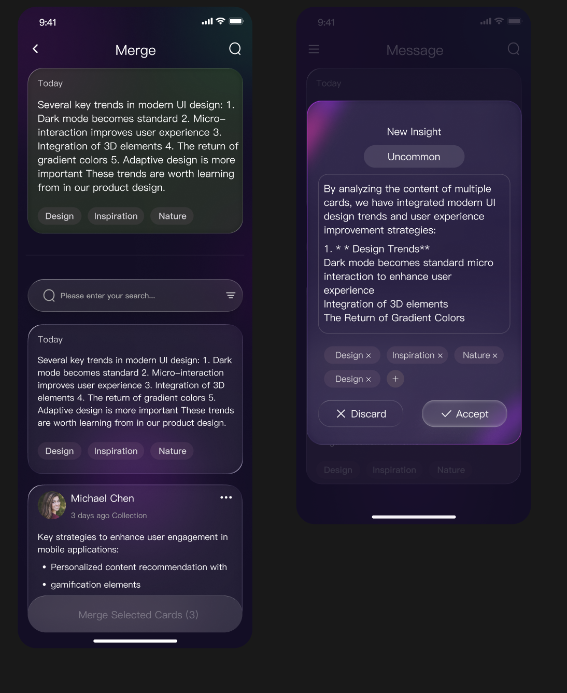
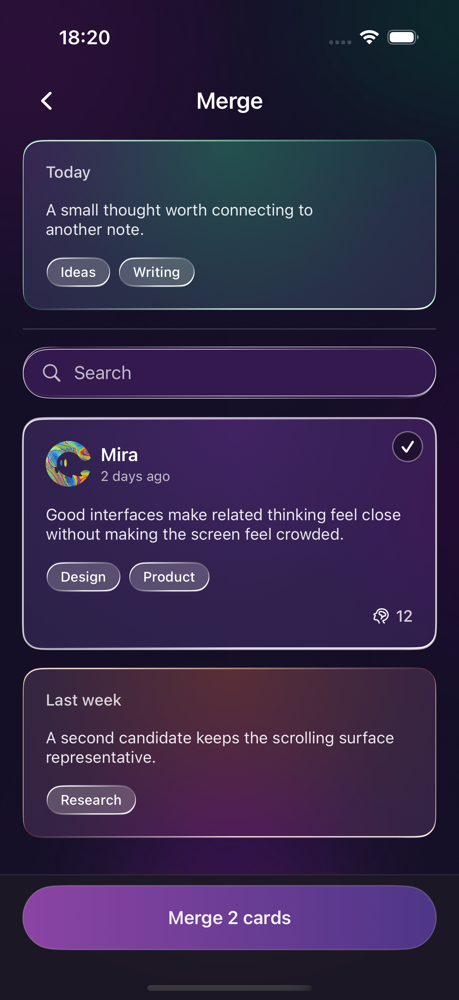
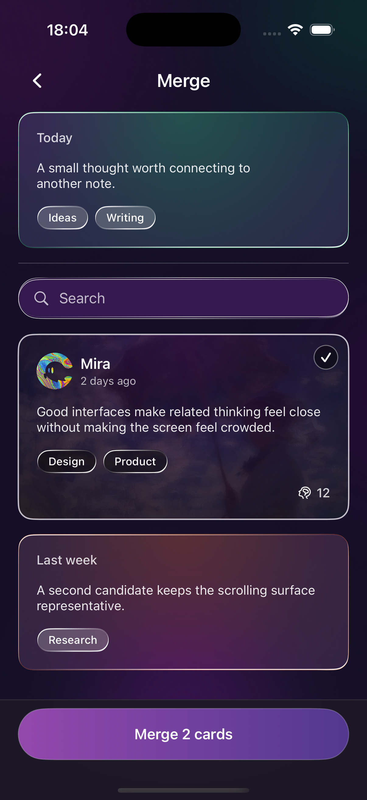
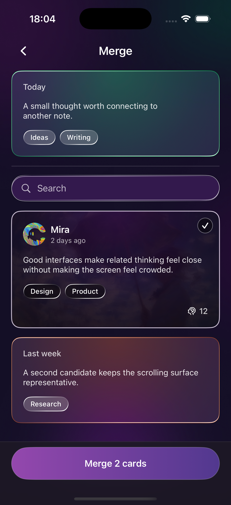
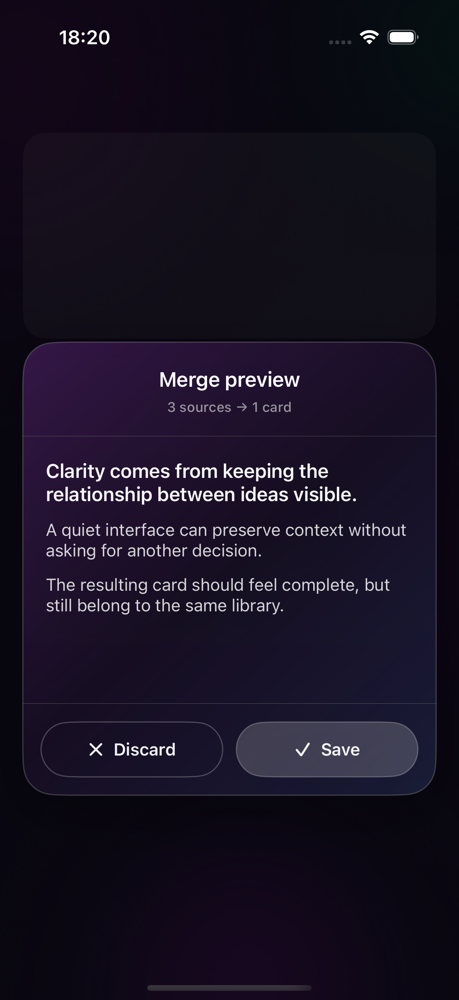
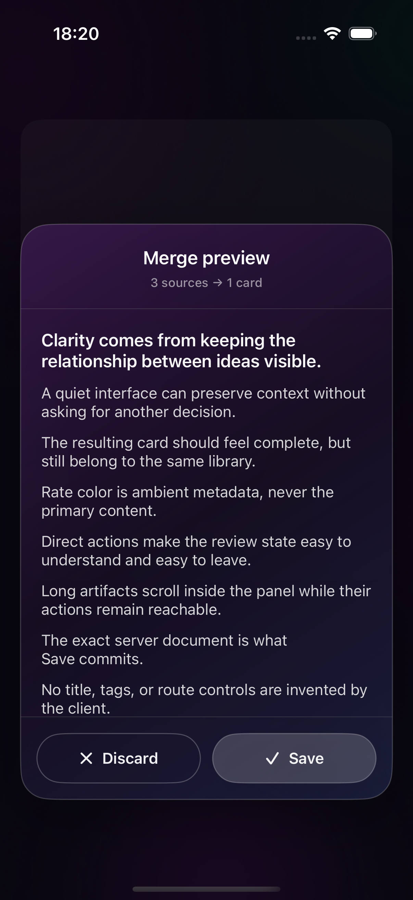
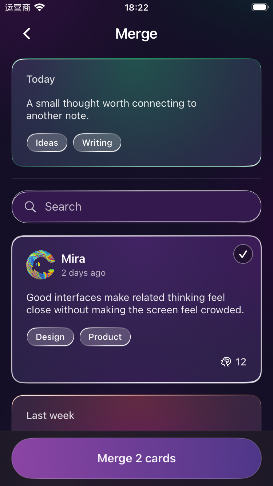
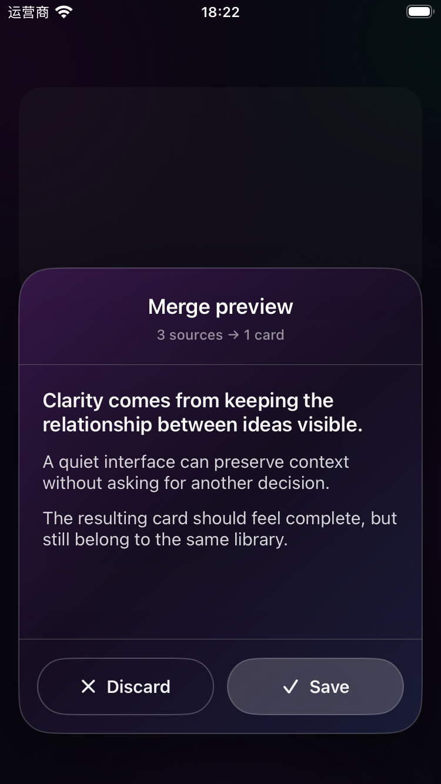

# iOS Zen Merge Redesign QA

## Scope

This audit covers the iPhone Merge selection and artifact-review flow after its
alignment with the current Merge v2 backend contract, the Web lifecycle, and the
supplied original iOS composition. It also covers the shared Home, Favorite, and
Merge card-rate presentation introduced by this work.

The runtime checks used iOS 26.2 simulators in dark appearance:

- iPhone 17 Pro, 402 x 874 points / 1206 x 2622 pixels.
- iPhone SE (3rd generation), 375 x 667 points / 750 x 1334 pixels.
- iPhone 17 Pro with Increase Contrast enabled, then restored to disabled.

## Visual evidence

1. The supplied original iOS design established the quiet hierarchy: fixed
   source card, search, candidate list, one bottom action, and a centered review
   surface.

   

2. The accepted iPhone 17 Pro selection state has one `Merge` title, the fixed
   anchor, one search field, direct card selection, and one safe-area action.
   Rates 2, 4, and 6 render as green, purple, and orange-red ambient treatments.

   

3. A real locally served background image is visible behind the selected rate-4
   candidate. The shared veil keeps author metadata, content, tags, and selection
   treatment readable without hiding the image.

   

4. Increase Contrast strengthens card and rate rims while preserving the same
   restrained hierarchy and readable custom background.

   

5. The short server artifact appears in a centered glass panel with no navigation
   header, editable metadata, legacy `New Insight` content, or close control. Its
   only actions are `Discard` and `Save`.

   

6. Long server content scrolls inside the same panel while both actions remain
   fixed and reachable.

   

7. On the compact iPhone SE, the deep Material action dock prevents list content
   from bleeding through the primary action and keeps the button inside the safe
   area.

   

8. The compact artifact remains centered, readable, and fully actionable without
   clipping.

   

All eight files were reopened and inspected at original resolution. No clipping,
overlap, hidden action, redundant interaction, false rate tier, or unreadable
background remains in the accepted captures.

## Backend and interaction audit

- Card detail now decodes the current `CardDTO`, including `content_json`,
  `background_media_ref`, author/count fields, and `rate`; the fixed Merge anchor
  receives its canonical rate instead of a hard-coded value.
- The shared rate contract is literal and bounded: 1 neutral, 2 `#00FF66`, 3
  `#0371FF`, 4 `#9627D2`, 5 `#D97800`, and 6 `#FF5E00`. Unknown values are neutral.
- Home, Favorite, Search, Discovery, and Merge use the same background surface;
  the legacy `NotesColorCard` and exponential rate ranges are gone.
- Selection always counts the anchor, enables at two total cards, uses direct card
  taps, and presents one wide `Merge N cards` action.
- `MergeSessionStore` remains the lifecycle authority. Save commits the exact
  titleless artifact through its persisted idempotent request. Transport and
  incomplete-response failures keep the artifact visible and retryable.
- Discard performs the canonical cancellation once and returns directly to fresh
  selection after success. A cancellation failure keeps the artifact with an
  inline error.
- In artifact-ready, committing, and discarding states, navigation/header chrome
  is removed from layout and the underlying selection surface is dimmed,
  noninteractive, and hidden from accessibility.

## Accessibility evidence and limits

Interactive controls retain at least 44-point targets. Selection and artifact UI
tests resolve labeled controls and verify the actions are hittable and inside the
window on both devices. Increase Contrast was exercised with a real custom
background; Reduce Motion and Reduce Transparency continue to use explicit
environment branches, including an opaque bottom dock and artifact surface.

These checks do not claim full VoiceOver, Switch Control, or measured contrast
compliance. No manual spoken traversal was recorded.

## Final verification

| Gate | Result |
| --- | --- |
| Complete CoreFlow package | 614 passed / 0 failed |
| iPhone 17 Pro focused Merge UI | 3 passed / 0 failed |
| iPhone SE 3 focused Merge UI | 2 passed / 0 failed |
| `ArcNote` Debug simulator build | `BUILD SUCCEEDED` |
| `ArcNote Production` / `Debug-Production` simulator build | `BUILD SUCCEEDED` |
| `git diff --check` | passed |

The app target has no testables in the `ArcNote` scheme; focused UI automation is
correctly run through the `ArcNoteUITests` scheme. The final commands were:

```bash
swift test --package-path Packages/CoreFlow

xcodebuild test \
  -project ArcNote.xcodeproj \
  -scheme ArcNoteUITests \
  -destination 'platform=iOS Simulator,id=43E6164C-1F4B-47E4-9B65-D154C7281A56' \
  -only-testing:ArcNoteUITests/ArcNoteUITests/testMergeSelectionFixtureUsesOneFullWidthSafeAreaAction \
  -only-testing:ArcNoteUITests/ArcNoteUITests/testMergeArtifactFixtureUsesCenteredTwoActionPreview \
  -only-testing:ArcNoteUITests/ArcNoteUITests/testMergeLongArtifactKeepsActionsReachable \
  CODE_SIGNING_ALLOWED=NO

xcodebuild test \
  -project ArcNote.xcodeproj \
  -scheme ArcNoteUITests \
  -destination 'platform=iOS Simulator,id=86CD9628-7C27-4799-B237-3EEC82E7E9B5' \
  -only-testing:ArcNoteUITests/ArcNoteUITests/testMergeSelectionFixtureUsesOneFullWidthSafeAreaAction \
  -only-testing:ArcNoteUITests/ArcNoteUITests/testMergeArtifactFixtureUsesCenteredTwoActionPreview \
  CODE_SIGNING_ALLOWED=NO

xcodebuild -project ArcNote.xcodeproj -scheme ArcNote \
  -configuration Debug \
  -destination 'platform=iOS Simulator,id=43E6164C-1F4B-47E4-9B65-D154C7281A56' \
  CODE_SIGNING_ALLOWED=NO build

xcodebuild -project ArcNote.xcodeproj -scheme 'ArcNote Production' \
  -configuration Debug-Production \
  -destination 'platform=iOS Simulator,id=43E6164C-1F4B-47E4-9B65-D154C7281A56' \
  CODE_SIGNING_ALLOWED=NO build
```

## Requirement audit

- [x] Original iOS hierarchy restored without copying obsolete artifact controls.
- [x] Current Merge v2 create, poll, artifact, exact commit, and cancel semantics retained.
- [x] One direct selection interaction and one count-bearing primary action.
- [x] Centered titleless artifact panel with exactly Discard and Save.
- [x] Canonical card DTO fields and rates survive every Merge projection.
- [x] Home, Favorite, Search, Discovery, and Merge share one rate surface.
- [x] Canonical rates 1 through 6 and neutral unknown handling are tested.
- [x] Custom-background readability and Increase Contrast are visually checked.
- [x] Short and long artifacts are checked on the normal iPhone.
- [x] Selection and artifact layouts are checked on the smallest supported fixture.
- [x] Complete CoreFlow, focused UI, and both build configurations pass.

final result: passed
