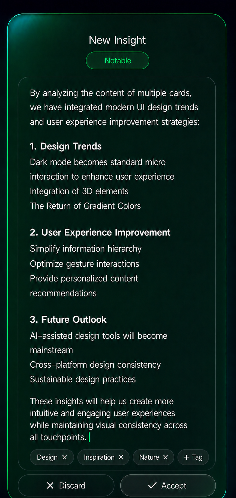

# iOS Merge WYSIWYG Preview and Rail Placement Design

**Date:** 2026-08-17

**Status:** Ready for written-spec review

**Scope:** iOS presentation and lifecycle integration, plus the minimum additive Go Merge artifact contract required for atomic WYSIWYG persistence



The approved crop is authoritative for the card material, level treatment, content editor, tags, and mutation actions. App-level Back navigation and the task rail are intentionally specified in text because they sit outside this cropped card surface.

## 1. Objective

Turn the completed Merge artifact into one calm, full-content, WYSIWYG card surface. A user reads by scrolling, edits by tapping the content, manages tags with the same controls as Card Editor, and accepts exactly what is visible. There are no separate Preview and Edit tabs.

The Merge task rail moves to the right-side slot immediately above the New Note button and expands upward. Closing the Merge surface never discards, commits, cancels, or replaces the job; a pending draft sync may finish in the background. Discard removes the task; a successful Accept removes the task and opens the committed Card.

The feature must preserve the existing background multi-Merge guarantees: multiple jobs, durable job ownership, relaunch recovery, exact revision commit, actor isolation, retry/cancel rules, and one global task rail.

## 2. Approved product decisions

- A Merge selection screen remains full-screen until the server creates a job and returns its `jobId`.
- Successful creation minimizes automatically into the task rail. Creation failure stays on the selection screen with an error.
- Multiple Merge jobs may run concurrently and survive app termination.
- Working, Complete, Recovering, and Failed remain task states; opening or closing a task does not mutate them.
- Closing a completed preview keeps the Complete task in the rail.
- Discard cancels and removes only the selected task.
- Accept commits the latest saved artifact revision, removes the task, and opens the canonical committed Card.
- The completed artifact is one WYSIWYG reading/editing surface. Scrolling is preview; tapping the content focuses the editor in place.
- Tags reuse the existing Card Editor capsule language. They have no colored dots.
- The numeric `rate` is never displayed. The UI shows only the semantic level and its card material.
- A result rate of `3` is `Notable` and uses the approved deep-green glass treatment.
- The card boundary is a continuous restrained level-colored edge. Purple may remain in the distant page ambience, but never appears as an isolated right-side card stroke.

## 3. Relationship to the previous Merge design

This document supersedes the artifact-review and rate-presentation portions of `2026-08-13-ios-zen-merge-redesign-design.md`.

The previous document intentionally specified a read-only, titleless artifact panel with no tags or level treatment. The approved product direction now requires editable body content, editable tags, and a server-derived level material. The previous Merge vNext lifecycle, exact commit, provenance, idempotency, and source-card reuse decisions remain in force unless this document explicitly changes them.

`New Insight` is a fixed presentation heading in this surface, not an editable artifact title. The persisted Card title continues to use the backend's canonical title projection. WYSIWYG applies to the body document, tags, semantic level, and level material.

## 4. User experience

### 4.1 Task rail placement

The collapsed task rail occupies the same trailing alignment as the 56-point New Note button and sits 12 points above that button's top edge. The collapsed task control remains at least 44 by 44 points.

The app shell owns one layout guide for this slot:

- On Home, the guide is derived from the real New Note button frame, not from a duplicated magic number.
- On pushed Card routes where the New Note button is not visible, the rail retains the same screen-relative slot so it does not jump vertically during navigation.
- The rail respects the safe area and remains reachable on the smallest supported iPhone.
- Expansion grows upward from the collapsed control. It never grows down across the New Note button.
- At most four task controls are visible at once; additional tasks are reached with vertical scrolling.

The collapsed rail shows only the Merge glyph and aggregate task count. It does not show `Weaving`, `Preview`, or other text. Working uses restrained rotation; Complete is static; Recovering and Failed remain visibly distinct. With multiple tasks, the count is the primary collapsed signal.

### 4.2 Opening a completed task

Tapping a Complete task presents the Merge artifact above the current route without changing the job identity. A top-leading Back control minimizes the surface and restores the Complete rail. It does not discard, commit, or create a replacement job.

The global rail is hidden while any full-screen artifact surface is open, matching the established single-owner presentation behavior. Other concurrent jobs continue polling and saving in the background; the complete rail, including every task, reappears when the surface closes.

### 4.3 WYSIWYG content interaction

The artifact body uses the same BlockNote-capable editing surface as Card Editor.

- With no focus, the body is a normal scrollable preview.
- Tapping text places the caret at the tapped position and raises the keyboard without changing typography, spacing, width, or card material.
- There is no Preview/Edit segmented control and no separate editing route.
- Interactive keyboard dismissal returns to the reading state while preserving the draft.
- Selection, replacement, deletion, list editing, and supported inline formatting behave as they do in Card Editor.
- Unsupported artifact blocks remain readable and cannot be silently dropped. Accept is disabled if the local editor cannot serialize the full document losslessly.

The body receives the available height between the heading/level area and the metadata/actions area. Long content scrolls inside this region; it is never clipped behind the buttons.

### 4.4 Tags

Tags use the shared Card Editor components and behavior:

- Existing tag: deep-purple glass capsule, white label, trailing remove `x`.
- Add control: the same capsule language with leading plus and the label `Tag`.
- Internal spacing, typography, capsule radius, and minimum 44-point interaction area match Card Editor.
- No colored dot, rate color, or per-tag gradient is shown.
- The row scrolls horizontally when needed and does not compress labels into unreadable widths.
- The canonical backend limit remains ten normalized tags.

Tag mutations are part of the artifact draft. They are not deferred until after the Card has already been committed.

### 4.5 Actions

The bottom action row contains exactly two mutation actions:

- **Discard:** asks for confirmation, cancels the canonical job, clears the local draft, and removes only that task.
- **Accept:** first flushes the current draft to an accepted artifact revision, then commits that exact revision. On success it removes the task and opens the canonical Card.

Back/minimize is navigation chrome, not a third mutation action.

While a draft save is running, Accept is disabled and communicates progress in place. While commit is running, both mutation actions are disabled. A failed save or commit leaves the surface and draft intact and makes the relevant action retryable.

## 5. Level and material system

The server owns the result `rate`; the iOS client never edits or recomputes it. The client maps the returned value through one shared level style used by Merge and library cards.

| Canonical rate | Level label | Material accent |
| --- | --- | --- |
| `< 3` | `Basic` | neutral deep-violet glass |
| `3...8` | `Notable` | emerald green `#00FF66` |
| `9...26` | `Valuable` | blue `#0371FF` |
| `27...80` | `Significant` | purple `#9627D2` |
| `81...242` | `Exceptional` | amber `#D97800` |
| `>= 243` | `Definitive` | orange-red `#FF5E00` |

The level label is visible; the number is not. A rate of `3` therefore presents `Notable` with a premium deep-green card body, subtle emerald edge, and restrained green corner ambience. `Exceptional` is intentionally used instead of `Critical`: the tier communicates positive knowledge value rather than an error or severity state.

Every tier uses one coherent accent family across its card body, continuous edge, and restrained corner ambience. A green or amber card never inherits a blue outline from another tier. The shared style must use the existing `merge_bg_basic`, `merge_bg_green`, `merge_bg_blue`, `merge_bg_purple`, `merge_bg_yellow`, and `merge_bg_red` material assets as the visual baseline.

The approved green material follows these rules:

- deep near-black green glass body with readable white text;
- fine continuous emerald/teal edge on all four sides;
- no magenta or purple right-side stroke;
- restrained local glow rather than a neon outline;
- purple only as distant page ambience;
- Reduce Transparency replaces translucent material with an opaque high-contrast green surface;
- Increased Contrast strengthens text and edge separation without increasing decorative glow.

## 6. Atomic artifact metadata contract

### 6.1 Why an additive backend contract is required

The existing Merge vNext artifact revision stores the editable `card_doc.v1` body. Its current commit projection produces empty tags and rate `1`. Saving tags after commit through the normal Card update endpoint would create a partial-success state: the Card could exist while the preview still reports a failed Accept. That violates WYSIWYG, idempotency, and retry safety.

Body, tags, and the server-owned result rate must therefore belong to the same selected artifact revision and authoritative commit identity.

### 6.2 Presentation companion

Each artifact revision gains one immutable exact companion object:

```json
{
  "schemaVersion": "merge_artifact_presentation.v1",
  "tags": ["Design", "Inspiration", "Nature"],
  "rate": 3
}
```

The companion is stored and hashed separately from `card_doc.v1`; title, tags, and rate are not inserted into the reserved titleless CardDocument contract. The artifact revision binds the document object and presentation object together. Its revision-chain identity includes both hashes.

`GET /api/merge/jobs/{jobId}/artifact` adds the presentation object to the response. Existing document, revision, and hash fields keep their meaning.

`PUT /api/merge/jobs/{jobId}/artifact` remains the only artifact edit endpoint. Its additive input accepts normalized tags beside `doc`. The client cannot submit or override `rate`. A successful save creates one next revision containing the new document, new tags, and the unchanged server-owned rate.

The existing `baseRevision`, `baseHash`, and `idemKey` conflict/idempotency rules remain authoritative. A tag-only change still creates a new artifact revision, so `baseRevision` detects concurrent edits even when the document hash is unchanged. Request identity includes normalized tags.

Commit continues to select an exact artifact revision. The server loads the presentation object already bound to that revision, so the commit request does not need a second client-controlled metadata write. Existing Web behavior remains compatible; no Web visual redesign is part of this work.

### 6.3 Initial rate and tags

The initial presentation companion is derived once from the frozen source set:

- Each source contributes its canonical source rate. Missing or non-positive legacy values normalize to `1`.
- The result rate is the overflow-safe sum of those normalized source rates.
- Example: three rate-`1` sources produce result rate `3`, level `Notable`, and the green material.
- Source rates used by this calculation are frozen with the Merge source snapshot; later Card mutations cannot change an in-flight artifact's result level.
- Initial tags are the stable, normalized union of source tags in source-selection order and then source-tag order.
- Tags are trimmed, empty values are removed, exact duplicates are removed while preserving the first occurrence, and the existing ten-tag limit is applied.

User tag edits replace the proposed tag list for later revisions. Rate remains unchanged for every revision of the same artifact.

### 6.4 Authoritative commit and retryable projection

The selected revision's document and presentation companion are sealed by one backend commit transaction and one idempotent Merge commit identity.

- The immutable NOTE history receives the existing exact projected document plus the exact presentation companion needed to reconstruct mutable read models.
- The Kernel activity and required provenance bind the same selected revision and companion hash.
- The current Card projection derives tags and rate from that committed history through the existing retryable reconciliation boundary.
- The Card title continues to be derived by the existing canonical title projection.
- Commit replay returns the same Card and cannot duplicate or reapply metadata.
- Validation or exact-storage failure before the authoritative transaction rolls back the complete commit.
- If current-projection reconciliation fails after the authoritative commit, the API remains retryable and commit replay reconciles the same history. It cannot create a second Card or project different tags or rate.

## 7. iOS state and data flow

`MergeSessionStore` remains the lifecycle authority. It gains artifact-draft operations; the UI does not create a second Merge state machine.

### 7.1 Draft state

Each accepted job owns one draft keyed by actor identity and canonical `jobId`:

- base artifact revision and document hash;
- editable document;
- editable normalized tags;
- immutable rate and derived level style;
- dirty/saving/saved/error state;
- stable idempotency key for the pending save operation.

The durable task record stores enough draft context to restore unsaved work after app termination. It never stores another actor's draft in the active actor scope.

Canonical job phase and draft-sync phase remain separate. An artifact-ready job stays Complete when its local draft is dirty or temporarily unsynced; draft synchronization is communicated inside the artifact surface and through accessibility state, not by rewriting the job into a different lifecycle status.

### 7.2 Saving

- Local edits update the visible draft immediately.
- After 600 milliseconds without another mutation, the store sends one artifact-save operation.
- A new mutation while a save is in flight remains dirty and schedules the next save from the returned revision; it does not overwrite the in-flight request.
- Back/minimize first persists the current draft locally, returns immediately, and lets an online flush finish in the background. If the flush cannot complete, the durable draft remains attached to the Complete task and retries after recovery.
- Accept performs a mandatory flush and waits for the exact saved revision before commit.
- The same pending save replays with the same idempotency key after timeout, relaunch, or temporary network loss.

### 7.3 Conflict and stale responses

A `409` or stale base response does not silently replace local edits. The store fetches the latest artifact and compares it with the durable local draft:

- If the local draft is clean, adopt the latest revision.
- If local content is dirty, retain it and show a concise conflict state with `Reload server version` and `Keep my version` recovery choices.
- Choosing `Keep my version` rebases through the editor save endpoint only after the user explicitly selects it.

Late responses from an abandoned actor generation, discarded task, or replaced operation are ignored by the existing lifetime/generation gates.

## 8. Component boundaries

### `MergeArtifactEditorSurface`

Owns layout, focus, scroll, keyboard behavior, action presentation, and accessibility. It consumes a draft projection and emits user intents only.

### `MergeArtifactDraftController`

Owns document/tag mutation, dirty state, debounce, durable local draft, save replay, conflict handling, and mandatory Accept flush. It depends on `MergeSessionStore` and the artifact service interface.

### `MergeArtifactEditorCodec`

Owns the lossless boundary between `card_doc.v1` and the BlockNote-capable iOS editor model. It preserves block IDs, hierarchy, supported props, inline marks, and media references. A round-trip mismatch is an explicit validation error and disables Accept; the UI never commits a partially decoded document.

### Shared Card Editor primitives

The Merge surface reuses or extracts shared implementations for the BlockNote editor, `CardEditorTagRow`, and `CardMetadataTagCapsule`. Merge must not copy their styling into a second component family.

### `CardLevelStyle`

One shared pure value maps canonical rate to level label and visual accent. Existing library rate styling migrates to consume it so Merge and committed Card surfaces cannot disagree.

### `MergeTaskRailAnchor`

One app-shell layout guide connects the New Note button slot to the single global rail portal. It owns placement only; coordinator/task state remains outside it.

## 9. Error behavior

- Artifact load failure: keep Complete task ownership and offer Retry/Remove according to the existing centralized recovery policy.
- Draft validation failure: keep the user's draft, show the validation message near the editor, and disable Accept.
- Draft save timeout or temporary server failure: keep the lifecycle task Complete, show an inline unsynced/retrying state in the artifact surface, and replay the same operation.
- Offline editing: allow local edits and durable persistence; mark them unsynced and disable Accept until synchronization succeeds.
- Commit failure: keep the preview, exact saved revision, and Complete task; Accept becomes retryable.
- Discard failure: keep the task and preview; no local state is cleared until canonical cancellation succeeds.
- Relaunch: restore all tasks, restore each local draft, reconcile server status, then resume only eligible polling or save operations.

## 10. Accessibility and adaptive layout

- Every action, tag removal target, add-tag control, task control, and Back control has a minimum 44-point hit area.
- VoiceOver announces the level label, never the hidden numeric rate.
- Tag capsules expose one label and one removal action without duplicate decorative elements.
- The rail count is announced once by the collapsed control.
- Dynamic Type may increase the card height and body scroll range; it must not clip tags or mutation actions.
- On compact iPhones, the keyboard leaves at least one visible content line plus reachable dismissal and Accept state feedback.
- Reduce Motion removes the Working rotation and positional rail expansion; state changes remain perceivable.

## 11. Verification

### Go contract and integration tests

- Initial presentation derives deterministic source-order tags and an overflow-safe source-rate sum.
- Three rate-`1` sources return rate `3`; commit persists rate `3` and the edited tag list.
- Rate cannot be changed by an artifact edit request.
- Document edits, tag-only edits, and combined edits each create exactly one valid next revision.
- Idempotent replay returns the same revision; a different request under the same key is rejected.
- Stale base revisions conflict without writing another revision.
- Revision-chain and commit proof include the presentation companion hash.
- The authoritative commit is atomic across NOTE history, the presentation companion, activity, and provenance; retryable current-projection reconciliation reconstructs the exact document, tags, and rate.
- Existing Web artifact fetch/edit/commit flows remain contract-compatible.

### CoreFlow and iOS unit tests

- Rate-to-level mapping covers every threshold and invalid legacy input.
- Draft debounce coalesces rapid edits without dropping the latest document or tags.
- A tag-only draft persists and commits without a second Card update call.
- Back/minimize, reopen, app relaunch, offline recovery, and save timeout preserve the same job and draft.
- Accept waits for the current draft revision and cannot commit a stale revision.
- Discard clears only the target task; sibling jobs and drafts remain intact.
- Actor changes revoke old drafts and reject stale responses.

### UI and visual QA

- iPhone 17 Pro and the smallest supported iPhone show the rail above New Note with matching trailing alignment.
- A five-task rail expands upward, shows four visible controls, scrolls to the fifth, and never covers New Note.
- Working animation, Complete static state, aggregate count, Recovering, and Failed are visually distinct.
- Completed artifact opens, minimizes, reopens the same job, and retains local edits.
- Scrolling reads the artifact; tapping the body edits in place with no tab or layout jump.
- Tags visually match Card Editor and contain no colored dots.
- Rate `3` shows `Notable`, never `3`, and uses the approved continuous green edge with no purple or blue right border.
- Long content, Dynamic Type, Reduce Motion, Reduce Transparency, and increased contrast remain usable.
- Accept opens the canonical Card with the edited body, edited tags, and matching level material.

## 12. Out of scope

- A Web Merge visual redesign.
- Manual rate editing or a numeric rate display.
- Editable Merge title or changing the titleless `card_doc.v1` contract.
- A second Card Editor implementation dedicated to Merge.
- New AI regeneration, prompt, route, or surprise controls.
- Changing the established multi-job cancellation, retry, actor isolation, or canonical Card navigation policies.
- iPad-specific composition beyond normal adaptive SwiftUI behavior.

## 13. Acceptance criteria

The feature is complete when all of the following are true:

1. Job creation minimizes to the single durable rail and the rail sits above New Note.
2. Multiple tasks survive relaunch and the expanded rail grows upward without overlap.
3. Complete opens one full-content WYSIWYG artifact surface with no Preview/Edit tabs.
4. The user can edit the body and tags in place; closing and reopening preserves the same draft and job.
5. Tags exactly match Card Editor styling and contain no colored dots.
6. The UI hides numeric rate and maps canonical rate `3` to `Notable` with the approved green material and continuous green edge; every other threshold uses the approved `Basic`, `Valuable`, `Significant`, `Exceptional`, and `Definitive` mapping.
7. Accept atomically commits the latest body, tags, and server-owned rate, then removes the task and opens the canonical Card.
8. Discard removes only the selected task; Back/minimize removes nothing.
9. Offline, timeout, conflict, relaunch, and actor-change paths retain the existing lifecycle safety guarantees.
10. Required Go, CoreFlow, iOS UI, accessibility, adaptive-layout, and visual QA gates pass without regressions in the current Web Merge contract.
